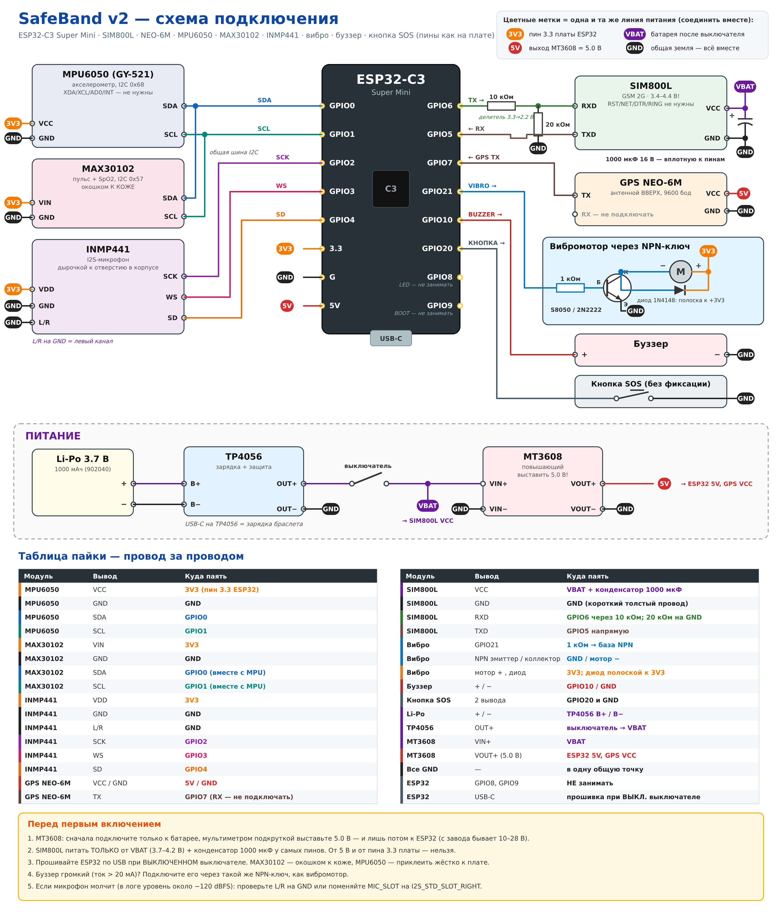

# SafeBand — прошивка браслета

| Папка | Для какой схемы | Модули |
|---|---|---|
| `SafeBand_v1/` | текущая спаянная плата | ESP32-C3 Super Mini, SIM800L, NEO-6M, MPU6050 |
| `SafeBand_v2/` | полная схема ([`docs/wiring_v2.png`](docs/wiring_v2.png)) | + MAX30102, INMP441, вибромотор, буззер, кнопка SOS |

Пины в обеих прошивках одинаковые (SIM800L — GPIO5/6, GPS — GPIO7), так что v2 — это та же плата с добавленными модулями. Схема текстом: [`docs/WIRING.md`](docs/WIRING.md).



## 1. Подготовка Arduino IDE

1. **Boards Manager** → установить **esp32 by Espressif Systems** версии **3.x**.
2. **Library Manager** → установить:
   - `TinyGPSPlus` (Mikal Hart) — для v1 и v2;
   - `SparkFun MAX3010x Pulse and Proximity Sensor Library` — только для v2.
3. Настройки в меню **Tools**:
   - Board: **ESP32C3 Dev Module** (или *Nologo ESP32C3 Super Mini*);
   - **USB CDC On Boot: Enabled** (обязательно: UART0 занят под SIM800L, логи идут через USB);
   - Upload Speed: 921600.
4. Откройте `SafeBand_v1/SafeBand_v1.ino` (или v2), заполните блок **НАСТРОЙКИ** вверху файла:
   ```cpp
   #define DEVICE_ID "SB-001"          // = braceletId в приложении
   const char *PHONES[] = { "+77001234567" };  // номер телефона с приложением (+ родственники)
   uint32_t REPORT_INTERVAL_MIN = 10;  // как часто слать статус
   const char *APN = "internet";       // APN вашего оператора
   ```
5. **Выключите выключатель питания**, подключите USB-C к ESP32 и нажмите Upload.
   Если загрузка не начинается: зажмите BOOT, нажмите и отпустите RST, отпустите BOOT.
6. Откройте Serial Monitor на 115200. Каждые 10 с печатается строка `[STAT]` с состоянием всех модулей.

> SIM800L при первом запуске может искать сеть до минуты. На SIM-карте должен быть отключён PIN-код,
> а для GSM-позиционирования нужен мобильный интернет.

## 2. Формат SMS

Каждое сообщение начинается со строки `SafeBand`, дальше идут строки вида `ключ: значение`.
Длина не больше 160 символов: если не помещается, менее важные строки отбрасываются.

```
SafeBand
type: status
id: SB-001
lat: 51.169412
lng: 71.449123
src: GPS
time: 2026-11-22T09:05:00Z
acc: 5
bat: 87
hr: 72
spo2: 98
worn: 1
```

| Ключ | Значение |
|---|---|
| `type` | `status` — плановый отчёт · `fall` — падение · `sos` — кнопка SOS · `ok` — человек нажал «я в порядке» после тревоги · `hr` — пульс вне нормы · `removed` — браслет снят · `lowbat` — батарея < 15 % · `on` — браслет включился |
| `id` | `DEVICE_ID` браслета |
| `lat`, `lng` | координаты в градусах (нет строк, если место неизвестно) |
| `src` | `GPS` — свежий спутниковый фикс · `GSM` — позиционирование SIM800L по вышкам · `LAST` — последнее известное место · `NONE` — неизвестно |
| `age` | только для `src: LAST`: сколько минут назад получены координаты |
| `acc` | примерная точность, м |
| `time` | время события в UTC (ISO 8601); для `fall` это время падения, а не время отправки |
| `bat` | заряд батареи, % (по напряжению на SIM800L) |
| `cell` | `MCC,MNC,LAC,CID` обслуживающей вышки (если нет GPS). По этим числам приложение может само найти место через OpenCellID / Google Geolocation API |
| `hr`, `spo2`, `worn` | только v2: пульс (уд/мин), сатурация (%), `1`/`0` — надет ли браслет |
| `map` | ссылка на Google Maps, если осталось место (удобно читать глазами) |

Пример разбора в приложении (TypeScript):

```ts
export function parseSafeBandSms(body: string) {
  const lines = body.trim().split('\n');
  if (lines[0] !== 'SafeBand') return null;
  const data: Record<string, string> = {};
  for (const line of lines.slice(1)) {
    const i = line.indexOf(':');
    if (i > 0) data[line.slice(0, i).trim()] = line.slice(i + 1).trim();
  }
  return data; // { type: 'fall', lat: '51.169412', ... }
}
```

> Читать входящие SMS из приложения можно **только на Android** (разрешение `READ_SMS` / `RECEIVE_SMS`,
> нужен development build Expo, не Expo Go). iOS не даёт приложениям читать SMS. Вариант на будущее:
> SIM800L умеет отправлять HTTP-запросы через GPRS прямо в Firebase Function, тогда SMS станут запасным каналом.

## 3. SMS-команды браслету

Принимаются только с номеров из `PHONES`. Проверка входящих — раз в 20 с.

| Команда | Действие |
|---|---|
| `LOC` (или `WHERE`, `STATUS`) | сразу прислать статус с координатами |
| `INT 5` | слать статус каждые 5 минут (1…120) |
| `FIND` | только v2: пищать ~10 с, чтобы найти браслет |
| `STOP` | только v2: выключить звук тревоги |

## 4. Как это работает

**Местоположение.** GPS работает постоянно и запоминает последний фикс. При отправке статуса:
1. если фиксу меньше 3 минут → `src: GPS`;
2. иначе (помещение) → `AT+CIPGSMLOC`, позиционирование SIM800L по вышкам, ~0,5–2 км → `src: GSM`;
3. если и это не вышло → последнее известное место, `src: LAST` + `age`, и вышка в `cell`.

> Сервис `CIPGSMLOC` у SIMCom работает не во всех странах и не у всех операторов. Если в логе
> всегда `позиционирование: не удалось`, поставьте `USE_GSM_LOCATION = false` и определяйте место
> в приложении по полю `cell`.

**Падение (MPU6050, 100 Гц).** Свободное падение (|a| < 0,45 g хотя бы 60 мс) → удар (> 2,2 g)
или просто очень сильный удар (> 3,5 g) → пауза 1,5 с → 2 с неподвижности (разброс < 0,15 g)
и поворот руки > 35° (или удар > 3 g). На компьютере алгоритм проверен на синтетических данных:
падение с лежанием после него — срабатывает; взмах рукой и «упал, но встал и пошёл» — нет.
**На живом человеке пороги нужно подобрать:** в логе видно `[FALL] проверка: sd=… угол=… пик=…`.

- **v1:** SMS `type: fall` уходит сразу.
- **v2:** буззер и вибрация, `CANCEL_WINDOW_SEC` = 10 с, чтобы отменить кнопкой («я в порядке»).
  Если не отменили, уходит SMS `fall`, звук держится 60 с. Нажатие кнопки после этого выключает звук
  и шлёт `type: ok`.

**Кнопка SOS (v2).** Удержание 2 с → SMS `type: sos`.

**Пульс (v2).** MAX30102 на 100 Гц: пульс по ударам (медиана последних 6), SpO2 по алгоритму Maxim
(окно 4 с). Если IR-сигнал ниже `WORN_IR_THRESHOLD`, считается, что браслет снят.
Пульс вне `HR_LOW..HR_HIGH` дольше 2 минут → SMS `hr` (не чаще раза в 30 минут).
Браслет снят дольше 5 минут → SMS `removed`.

**Микрофон → вибрация (v2).** Уровень звука считается каждые 16 мс, фоновый шум отслеживается
автоматически. Звук громче фона на 15 дБ и громче −50 dBFS (≈70 дБ) даёт одну короткую вибрацию.
Громкий звук дольше 1,5 с (сирена, будильник, крик) даёт серию из 3 вибраций. Пока работает свой
мотор или буззер, микрофон игнорируется, чтобы браслет не реагировал сам на себя.
Чувствительность настраивается в `SOUND_ABS_MIN_DBFS` и `SOUND_OVER_NOISE_DB`.

**LED на плате:** короткая вспышка раз в 3 с — всё в порядке; частое мигание — нет GSM; очень частое — тревога.

## 5. Если что-то не работает

| Симптом в Serial Monitor | Что проверить |
|---|---|
| `[GSM] модем не отвечает` | питание SIM800L от VBAT, конденсатор, TX/RX не перепутаны, делитель на RXD |
| `[GSM] нет регистрации в сети` | антенна, баланс, PIN-код снят, оператор поддерживает 2G |
| ESP32 перезагружается при отправке SMS | SIM800L просаживает питание: толще провода, ближе конденсатор, заряженная батарея |
| `GPS=нет(0 сп.)` | под открытым небом первый фикс занимает 1–5 минут; проверьте GPS TX → GPIO7 |
| `MPU=нет` | SDA/SCL (GPIO0/GPIO1), питание 3V3 |
| `MAX=нет` | та же шина I2C; модуль MAX30102 бывает на 1.8 В: нужен вариант с 3.3 В |
| `MIC … -120 dBFS` | L/R на GND; либо `#define MIC_SLOT I2S_STD_SLOT_RIGHT` |
| Буззер тихий или щёлкает | активный буззер → `#define BUZZER_IS_ACTIVE 1` |
| Ложные падения | увеличьте `IMPACT_G` / `HARD_IMPACT_G`, уменьшите `STILL_STD_G` |

## 6. Схема

Исходник схемы: `docs/make_wiring.py`. Если поменяли схему, перегенерируйте SVG:

```bash
python3 firmware/docs/make_wiring.py
```
